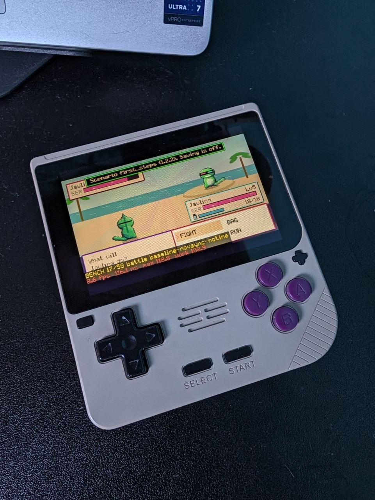

A few days ago, I was at the pub with a friend. 
He showed me some games he vibe-coded across the past few months and inspired me: we started talking about creating our own ironic monster-catching RPG. 
Being able to make that kind of game was a dream for me as a child. I spent whole afternoons on RPG Maker 2000 trying to develop many projects: obviously all of them failed miserably, but that experience was one of the most formative ones I had in those years, and it shaped my computational thinking.
Either way, I don't want to make this too philosophical; after 10 minutes of back-and-forth chat with Gemini, I had a design document for my over-the-top Pokémon lookalike. 
Both of us being completely hopeless at pixel art, he recommended Aseprite to me, which supports an MCP server and batch mode for sprite generation. I took the tip and went on to order another beer. We spent a couple of hours together and I quickly forgot about the matter.

## Vibe Coding a Monster-Catching RPG

While driving back home, I started thinking about the game again, and I decided to give it a try.
I fired up a coding agent (which one is completely irrelevant, trust me), and I asked it to pull my design document. We iterated together on various aspects of the game, and I decided on the overall architecture. I was mainly interested in having a web build so that I could host it on my GitHub Pages website and send it quickly to my friends.
After being satisfied with the implementation task list and the overall details we had decided, I put my agent in goal mode, and asked it to publish the full game to my website. At that point, I think I had spent maybe 2 hours total on the game.
I went to bed and in a few minutes I was fast asleep.

The next morning I woke up full of anticipation; I rushed up the stairs to my home office and increased the brightness of the screen: my game was there waiting for me. It was playable from start to finish, and it was already on my website: https://gioleppe.github.io/chakrageddon/ 


images/chakrageddon_sunset_cliff.png | A crowd waiting for the set at the Sunset Cliff, at dusk
images/chakrageddon_sweetwater_lake.png | Arambol Sweetwater Lake, with a pink mushroom on its island
images/chakrageddon_forest_stage.png | Dancers at the 190 BPM Forest Stage at night


It sure wasn't perfect (trees bordering the maps, I'm looking at you!), but it was there: pixel art, sound, the gameplay I had asked for. Everything materialized in front of my eyes in a few hours with little effort from me: I literally just wished for an outcome and gently asked a language model. Of course, it helped that I am an IT professional so I could somewhat guide the model and make decisions, but it was still impressive.
In moments like these, LLMs feel like alien technology. I was so much in awe that I spent the following couple of days iterating on the game after work, fixing or adding stuff, and putting in quests inspired by my real-life friends.
The quality of the work is good; it's clearly not an auteurist-level game, and I don't pretend to be the next Kojima just by vibe coding a funny monster-catching RPG; still, this is more than enough to strike up a few nice conversations with my friends and have fun playing it with them.

My childhood self would have sold his soul to the devil to be able to do something like this in such a short amount of time. Of course, as most developers know by now, working with coding agents is a very different experience than creating something brick by brick: you have to be comfortable with losing much of your control and accept the fact that you won't know the fine-grained details of your system. It's just unthinkable for a single person to audit all the code that these models spit out at breakneck speed.
This is something I had a hard time coming to terms with, and many colleagues are still struggling with the full paradigm shift AI imposes. Just a year ago I wrote that I mainly used AI to help me learn new stuff, and I only surrendered control when I was 100% sure about being an expert on the matter.
While I still somewhat stand by my words, I now have to admit that somehow the world has changed in the past 12-18 months, at least in my perception; lately I've been trying to be much more optimistic, so let's hope the change is for everyone's best.

Until we find out, I will certainly keep on vibe coding shitty games to have fun with my friends!

## B-Side: Quest for Portability
So I had this Powkiddy V10 lying around at home, I bought it a couple of years back to play GBA games while travelling for work. Lately it had been resting on a dusty shelf, because I was too absorbed by other stuff to play with it. 
I actually wanted to try porting the game to the (pretty bad) system. 
The Rockchip RK3326 doesn't have that much headroom and I was sure it would require library shimming. 
Fortunately, I had asked my agent to keep the code as vanilla as possible from the beginning, so it was straightforward to create the shims and build for my new target. I just issued a single prompt while watching a pretty bad reality series on the couch with my wife.
Within 10 minutes the game was already running on the Powkiddy using PortMaster, albeit with a few issues (including a pretty bad framerate admittedly); the agent had created a fully rebasable (my ask) branch to support the Rockchip build.
Next was improving performance. I thought about having an on-device benchmark and profiler to measure performance in a variety of situations: I already had most of the code ready from other automated checks of the standard build. I asked the coding agent and in a few minutes the benchmark was running on-device, as you can see below:

I'm not sure how much more I could squeeze out of my device. Unfortunately, the Rockchip port was an afterthought; otherwise, I would have planned around it and probably architected the whole thing slightly differently. 
I will probably try to add a graphics settings tab to tone down effects on low-end devices such as the Powkiddy, as most of the frametime is wasted on them.
If that doesn't work out, I will just ask for a complete native C (or Go, or whatever AOT compiled language is trending these days) rewrite. I'm probably just a prompt away from solving this! 